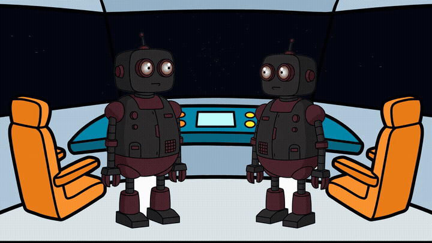
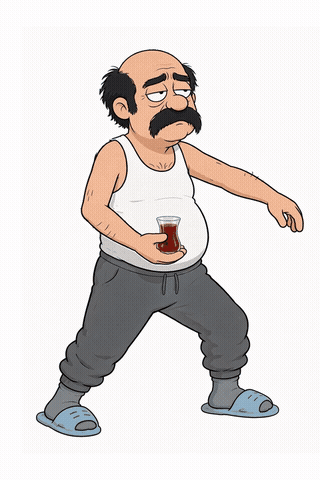
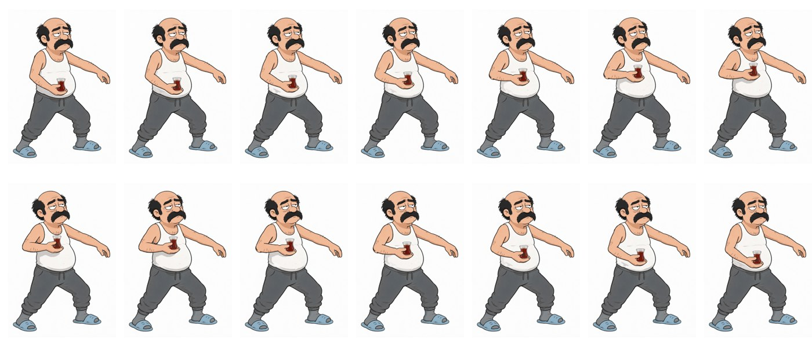
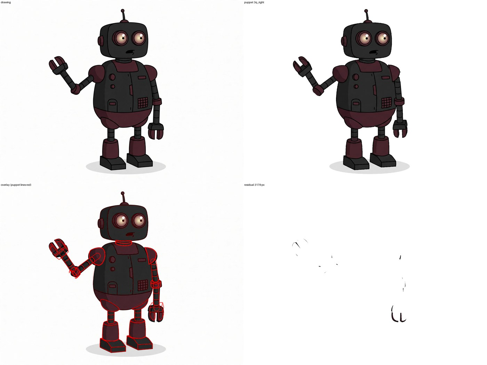
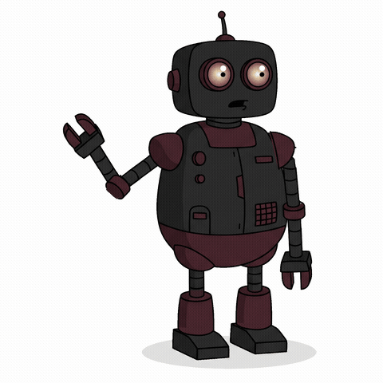
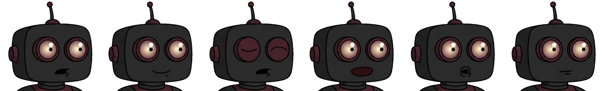
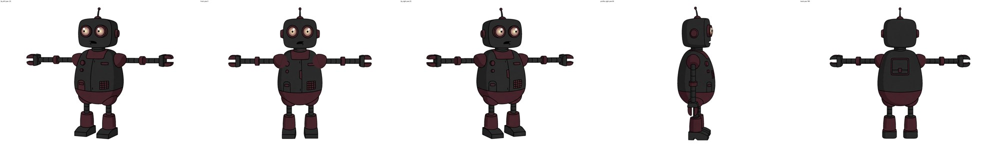

# karagoz-anim

**From a script to a finished 2D animated shot, made by a team of AI agents on Meta's models.**

[](LICENSE)


<p align="center">
  
</p>

> [!WARNING]
> **Version 0.0.1: an early preview, not a finished product.** The pipeline runs end to end and every result on this
> page was made with it, but many parts are incomplete. Expect rough edges and breaking changes. Read
> [Status and limits](#status-and-limits) before you use it.

You write a short script, give reference drawings of the characters and describe the location. karagoz-anim produces
a limited-animation shot (flat colour, black outlines, 1920×1080, 24 fps) with voices, lip-sync and in-betweens.
There is no video model. An image model draws the key poses, and the engine decides how the frames between them are
made.

Built for the **Meta Global AI Developer Hackathon** (26 Oct – 5 Nov 2026). The commit history is the record of what
was built and when.

## Contents

- [What it does](#what-it-does)
- [How it works](#how-it-works)
- [Two ways to make in-betweens](#two-ways-to-make-in-betweens)
- [The face system](#the-face-system)
- [Example: the rigged robot](#example-the-rigged-robot)
- [Quick start](#quick-start)
- [Commands](#commands)
- [Models and keys](#models-and-keys)
- [Status and limits](#status-and-limits)
- [Development](#development)
- [Licenses](#licenses)

## What it does

| | |
|---|---|
| **Runs alone** | `karagoz run` goes from script to MP4 with no one touching it (`human: off`). The cockpit scene above was made this way, with no approvals. The same pipeline can call a person at chosen steps (`human: full`). |
| **Agents write names, the engine writes numbers** | Agents write "Wonder stands at the left chair, facing Spark". The coordinate engine turns that into pixels using masks and scale from SAM 3.1. |
| **Time comes from the audio** | Every pose change is anchored to a word. The frame number comes from per-letter voice timings, never from a guess. |
| **A layered puppet for in-betweens** | Characters with a puppet set get in-betweens that cost nothing and cannot drift off-model. The engine decides per interval whether the puppet can do it. |
| **Errors go back to whoever made them** | When a code step fails because an agent wrote a bad file, that agent gets a retake note naming the step, the file, the field and what was expected. |
| **It measures itself** | Every step writes timing spans; `karagoz profile` shows time per step, the critical path and the parallelism. |
| **Cached by content** | A second run redraws only what changed (the demo shot's redraw: 43 jobs cached, 0 calls, $0.00). |

## How it works

```
script, characters, location
        │
        ▼
 Location ─ Muse Image draws the background; SAM 3.1 finds the objects (chairs, window, floor)
 Director ─ Spark agent: lines.yaml (who says what), shots.yaml (who stands where, facing whom)
 Voice    ─ MMS-TTS (local): one audio file per line, with a time for every letter
 Continuity ─ Spark agent: each character's state at the start and end of every shot
 Layout   ─ Spark agent: the key poses, and a description of every in-between
 Timer    ─ Spark agent: the x-sheet, each pose anchored to a word in the audio
 Draw     ─ Muse Image: key poses, mouth and eye variants; in-betweens by path A or B
 Render   ─ coordinate engine + ffmpeg: placement, lip-sync, blinks, camera, sound mix
        │
        ▼
      MP4
```

Studio agents are Muse Spark 1.3 in Contributor mode. Each department gets a compiled context (a shared core plus
tagged sections, see [`guide/`](guide/README.md)) and writes small YAML files that a schema checks.

## Two ways to make in-betweens

The image model draws only the **key poses**, the moments that carry the acting. Between two keys the engine uses one
of two paths.

### Path A: drawn in-betweens

Muse Image draws each in-between from its neighbouring keys and a motion description written by the Layout agent.
Each drawing starts from the previous one, so the design stays the same. This works for any character and any move
(turns, knees, arms toward the camera) and costs about $0.01 a frame. Small details can drift, because every frame is
a new drawing. All in-betweens of the cockpit scene above came from this path.

### Path B: the rig

The engine cuts the character into parts and moves the parts itself: no image calls, and no drift.

**B1. X→Y rig.** From two drawn keys, the engine measures which limbs changed and cuts them from the drawings. The
head is a rigid layer, the arm is a chain of parts, the torso bends a little with the arm, an area that opens up is
filled from the other key, and the floor shadow has its own layer.

<p align="center">
  
  <br>
</p>

Above: Recep raises his tea glass. The two end poses are drawn keys; the frames between them were made by the X→Y
rig during its development, during the hackathon. The engine now lives in `src/karagoz/engine/rig/`.

**B2. The layered puppet.** Built once per character from five reference views. Each view is cut into 19 parts.
Pivots, joint limits and slack are measured from the shapes, and parts hidden in a view are completed under the
parts that cover them. Then, for every key the model draws:

1. **Fit.** Pick the view that explains most of the drawing. Place the body, then turn each limb chain (2–5 joints
   together) until the puppet's lines and colours sit on the drawing.
2. **Decide**, per interval:
   - `rig`: every changed limb reaches the next key and no joint turns more than 27°. The puppet draws the frames.
   - `split`: a clean but large move. Add keys in between.
   - `ret`: the puppet cannot build this drawing (no knee, an arm toward the camera, a turn between views). Fall back
     to path A.

   Measured on the robot: poses the puppet builds leave 0.2–0.9% of the drawing unexplained, poses it cannot build
   leave 6–12%, and the line is drawn at 3%.
3. **Render.** Angles move on the shortest path with easing, locked parts stay pixel-still, and the holds come from
   the puppet too, so there is no jump at the keys.

<p align="center"></p>

## The face system

Faces are not redrawn per frame. Each key pose gets a small library of face patches:

1. **Variants.** Muse Image makes copies of the key with only the mouth, or only the eyes, changed. Mouth shapes come
   from a table: A `m b p`, B `i`, C `e`, D `a`, E `o ö`, F `u ü`, G `f v`, H `l`. Eyes come half closed and closed.
2. **Patches.** The engine compares each variant with the key and cuts out only what changed, inside the face that
   SAM found. The body is never taken from a variant.
3. **Lip-sync.** Per-letter voice timings map to mouth shapes, frame by frame.
4. **Blinks** are placed on the x-sheet, including one just before a character starts to speak.
5. **On a puppet**, a patch rides on the head part and moves with the head's own transform.

<p align="center">
  
  <br>
</p>

In the wave above, the two keys were drawn by Muse Image and the 7 frames between them by the puppet. The face patches
were placed with the engine's pieces by a script; doing this inside `karagoz run` is on the list below.

## Example: the rigged robot

[`examples/robot/`](examples/robot/README.md) holds a ready-made puppet of the demo robot: five views, 19 parts per
view, and key drawings to try it on.



```sh
uv run karagoz puppet chain examples/robot/set examples/robot/keys/wave_b.png examples/robot/keys/wave_c.png out/wave
# wave_b -> wave_c: rig
```

## Quick start

Requirements: Python 3.12+, [uv](https://docs.astral.sh/uv/), ffmpeg on `PATH`, and a Meta Model API key.

```sh
uv sync --extra mms                     # the mms extra adds torch + transformers for the local voices
git config core.hooksPath .githooks     # secret check before every commit
```

Keys live outside the repository in `~/.karagoz-anim/.env` (template: [`.env.example`](.env.example); override the
path with `KARAGOZ_ENV`). Then check the setup:

```sh
uv run karagoz doctor                   # keys and tools; never prints secret values
```

A full pass from episode files to an MP4 (production directory `prod`, episode `ep01`, shot `sh01`):

```sh
uv run karagoz voice prod ep01          # voice lines (cached by content)
uv run karagoz run prod ep01            # the studio agents write the episode's files
uv run karagoz draw prod ep01 sh01      # every drawing the shot needs, puppet in-betweens included
uv run karagoz landmarks prod ep01 sh01 # measure every body drawing of the shot
uv run karagoz render prod ep01         # shots to MP4, joined into the episode
uv run karagoz profile prod/ep01/run/events.jsonl  # where the time went
```

The whole workflow (production layout, running the studio, failures) is in the
[`karagoz` skill](.claude/skills/karagoz/SKILL.md); puppets are in the [`puppet` skill](.claude/skills/puppet/SKILL.md).

## Commands

| Command | What it does |
|---|---|
| `karagoz doctor` | check keys and tools (never prints secret values) |
| `karagoz check` | check that an episode's files agree with each other |
| `karagoz voice` | synthesize an episode's voice lines |
| `karagoz run` | run the studio pipeline for an episode |
| `karagoz status` | show the task board |
| `karagoz approve`, `karagoz retake`, `karagoz answer`, `karagoz done` | the human steps: approve, send back, answer a question, finish a human task |
| `karagoz mouth` | write mouth tracks from letter timings |
| `karagoz draw` | draw every asset a shot needs (`--no-puppet`: every in-between by the image model) |
| `karagoz recut` | re-cut a shot's mouth and eye patches inside the face |
| `karagoz render` | render a shot or an episode to MP4 |
| `karagoz profile` | summarize a run's time from its timing spans |
| `karagoz regress` | compare rendered frames with golden ones; log time and cost |
| `karagoz questions` | count the questions agents asked |
| `karagoz regions` | build a location's region map from its background (SAM) |
| `karagoz landmarks` | measure the landmarks of every body drawing of a shot (SAM) |
| `karagoz parts`, `karagoz sheet` | a shot's movement parts, one contact sheet per part |
| `karagoz sheet-files`, `karagoz look`, `karagoz strip` | contact sheets from files, close looks, video frame strips |
| `karagoz gate` | flag a shot's drawings (jumps, wrong way, prop count); never rejects |
| `karagoz review` | write the shot's REVIEW.md again and print it |
| `karagoz redraw`, `karagoz keep`, `karagoz context` | redraw drawings, keep a finding with a note, set one task's context |
| `karagoz puppet` | build a puppet set (`build`, `build-set`, `repivot`), fit keys and render in-betweens (`fit`, `chain`, `transition`, `inbetween`) |

Run `uv run karagoz <command> --help` for the arguments.

## Models and keys

Every model the pipeline calls at runtime is a Meta model. Everything else is local code.

| Part | Kind |
|---|---|
| Studio agents, checkers, vision checks | **Meta model call:** Muse Spark in Contributor mode only (`muse-spark-1.3-contributor`, `muse-spark-1.2-contributor`) |
| Backgrounds, key poses, face variants, drawn in-betweens | **Meta model call:** Muse Image |
| Object masks, region maps, landmarks | **Meta model call:** SAM 3.1 (Meta's **SAM License**, also covering `meta-sam-parser`) |
| Voices with letter timings | **Meta open model, run locally:** MMS-TTS (`facebook/mms-tts-eng`) |
| Coordinate engine, puppet engine, lip-sync, blinks, camera | local code, no model |
| Audio and video encoding | local tool: ffmpeg |
| ElevenLabs voices | optional integration, off by default, not used in the hackathon build |

Keys (names only): `META_API_KEY`; optionally `ELEVENLABS_API_KEY`. Paid live tests are opt-in (`KARAGOZ_LIVE=1`).

Model terms and every dependency's license: [THIRD_PARTY_LICENSES.md](THIRD_PARTY_LICENSES.md). Note that MMS-TTS is
**CC-BY-NC-4.0** (non-commercial).

## Status and limits

Version 0.0.1. Working today:
- the full pipeline end to end;
- path A in-betweens;
- the layered puppet for poses it can build;
- lip-sync, blinks, caching and timing profiles.

Not done yet:
- **Puppet coverage.** No knees, no foreshortening toward the camera, no turns between views inside an interval. Such
  poses are detected and fall back to path A. In the cockpit scene every interval fell back. The causes are measured,
  not fixed yet: a far arm fitted across the chest, a sideways arm throwing off the body scale, and keys drawn at a
  slightly different angle from the puppet's reference.
- **Faces on puppet frames** inside `karagoz run`. Today this is done by a script.
- **Large puppet moves.** A `split` interval needs extra keys drawn precisely, and the image model lands them only to
  within about 15–20°.
- **Effects.** There is no effect system (particles, animated background layers). The starfield in the cockpit
  window was written for that scene only and is not part of this code.
- **Human review tool.** The `human: full` mode exists, but its review interface is still being built.
- **Speed.** A 5-key puppet chain takes about 4.5 minutes on a 12-thread machine.
- **Platform.** Developed on Windows. On Windows, a process-pool error can make the full test suite fail when it runs
  in parallel; the same tests pass alone and on Linux CI.

## Development

All four checks must pass before a commit:

```sh
uv run ruff check . && uv run ruff format --check . && uv run mypy && uv run pytest -q
```

Coding agents start at [`AGENTS.md`](AGENTS.md); the studio's own agents start at [`guide/README.md`](guide/README.md).
The code map is in [`ARCHITECTURE.md`](ARCHITECTURE.md).

## Licenses

The code is released under the [MIT License](LICENSE). The models it calls and the content they generate keep their
own terms; see [THIRD_PARTY_LICENSES.md](THIRD_PARTY_LICENSES.md).
