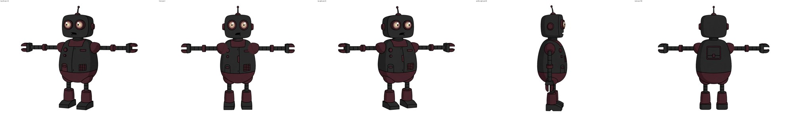
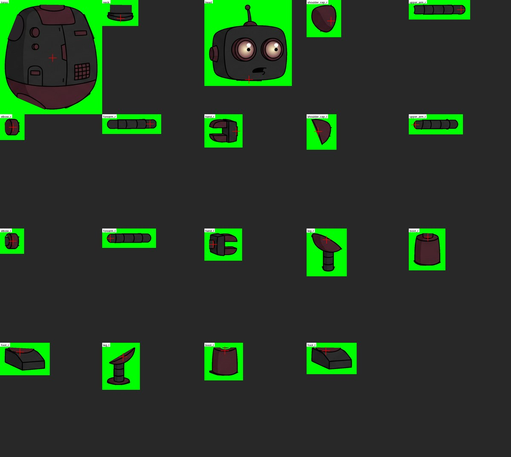

# Example: the rigged robot

A ready-made layered puppet of the demo robot. You can fit it to new drawings and render in-betweens without
building a set first.



## What is here

| Path | What |
|---|---|
| `reference/robot.jpg` | the original character drawing the views were made from |
| `reference/*.jpg` | the five reference views (front, 3/4 left, 3/4 right, profile, back), downscaled for viewing |
| `set/set.json` | the set: views and their yaw angles |
| `set/views/<view>/puppet.json` | one view's puppet: 19 parts, parents, z order, pivots, joint limits, slack |
| `set/views/<view>/parts/*.png` | the cut parts, each completed under the parts that cover it |
| `set/views/<view>/report.json` | the build's own checks for that view |
| `keys/arms_down.png` | a key pose: both arms down (3/4 right) |
| `keys/wave_b.png`, `keys/wave_c.png` | two key poses of a wave; the puppet can draw the frames between them |



## Try it

Fit the puppet to one drawing. This writes `pose.json` and a `fit_sheet.png`: the drawing, the puppet, their overlay
and what is left unexplained.

```sh
uv run karagoz puppet fit examples/robot/set examples/robot/keys/wave_b.png out/fit_b
```

Fit two keys and decide the interval (`rig`, `split` or `ret`):

```sh
uv run karagoz puppet chain examples/robot/set examples/robot/keys/wave_b.png examples/robot/keys/wave_c.png out/wave
```

Expected result: `wave_b -> wave_c: rig` (the largest joint change is under 27°).

Render the in-betweens. The renderer reads the two key drawings next to the transition as `X.png` and `Y.png`; in
production the draw step puts them there.

```sh
cp examples/robot/keys/wave_b.png out/wave/wave_b__wave_c/X.png
cp examples/robot/keys/wave_c.png out/wave/wave_b__wave_c/Y.png
uv run karagoz puppet inbetween examples/robot/set out/wave/wave_b__wave_c/transition.json out/wave_frames --frames 7
```

One fit takes about 2–3 minutes on a 12-thread machine. `KARAGOZ_WORKERS` sets the number of worker processes.

## Limits of this puppet

- The robot has no knees. A crouch or a jump cannot be built, and the engine marks it `ret`.
- It cannot foreshorten an arm toward the camera or turn between views inside one interval.
- Its keys work best when they are drawn at the same angle and stance as the reference. Keys drawn freely inside a
  scene can come out at a slightly different angle, and the far shoulder and far leg then stop matching.

The drawings were generated with Muse Image; see [THIRD_PARTY_LICENSES.md](../../THIRD_PARTY_LICENSES.md).
